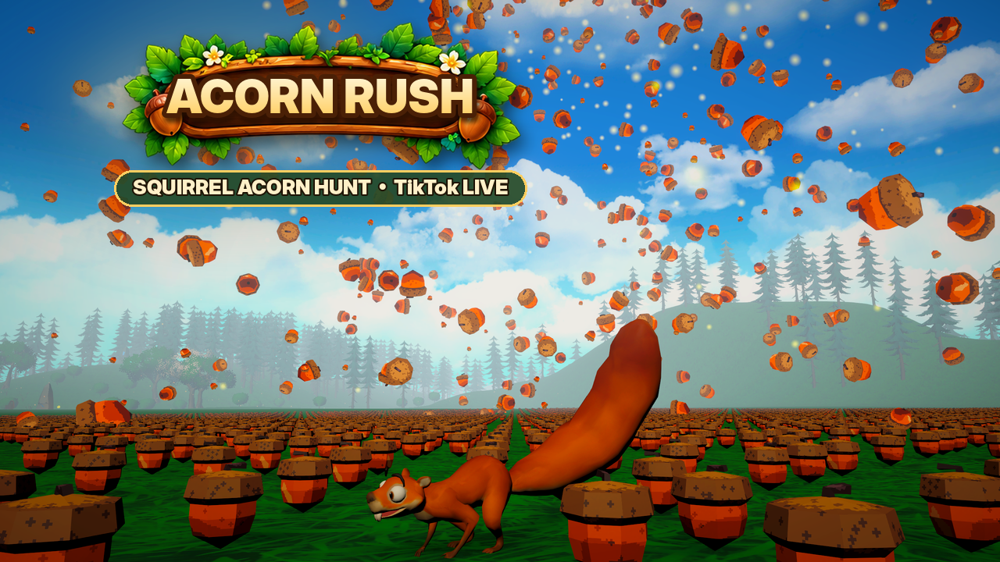
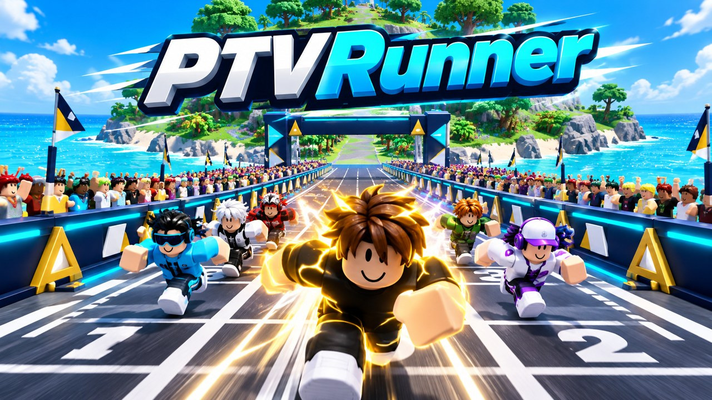

# PTVgame — Windows Launcher

## Acorn Rush — Launcher 1.8.0

เกม Unity ลำดับที่ 5: **Acorn Rush** (ชื่อเดียวกับในเกม) จากโปรเจกต์ Unity PTVegg กระรอกวิ่งเก็บลูกโอ๊กในทุ่ง มีระบบ XP/สกิล และเชื่อม TikTok LIVE ก่อนเล่น ของขวัญทำให้ลูกโอ๊กตกลงมาในทุ่ง ตั้งแต่ +500 จะมีคัตซีนฝนลูกโอ๊ก เลือกภาษาอังกฤษ/ไทยได้ในเกม (เริ่มต้นเป็นภาษาอังกฤษ)



ID `ptvegg`, manifest `release-manifests/ptvegg.json`, executable `AcornRush/AcornRush.exe`, เกมเวอร์ชัน 1.0.0 ใช้ silent mandatory update gate แบบเดียวกับเกม Unity อื่น ZIP มีโฟลเดอร์ `TikTokBridge` (Node runtime) ข้าง EXE สคริปต์ gate/build อยู่ใน `unity-update/PTVegg/` ภาพปกเรนเดอร์จากฉากจริงในเกม ดู ARTWORK.md

ลำดับการปล่อย: อัปโหลด `AcornRush.v1.0.0.zip` ไปที่ Release `ptvegg-v1.0.0` ก่อน แล้วจึง push `release-manifests/ptvegg.json` และ catalog/ภาพปก (Launcher 1.8.0 สร้างผ่าน GitHub Actions เมื่อ push)

Launcher 1.7.3 adds the selected gold NEW ribbon as a separate transparent PNG on the PTVRunner card. Its cover refreshes from the published Roblox experience thumbnail (universe 10771728798), with packaged artwork as an offline fallback. The ribbon does not modify the Roblox cover itself; favorites move to the card's upper right to keep the ribbon clear.

Launcher 1.7.2 fixes updater ERROR_PARTIAL_COPY (ReadProcessMemory/WriteProcessMemory) when the old launcher exits. The updater now waits on a process handle without inspecting MainModule, handles already-exited processes, and runs the newly downloaded updater. Users currently blocked in an older Updater should close that dialog, extract the 1.7.2 ZIP to a fresh folder, and run PTVgame-Launcher.exe once from there. Installed games/settings remain in LocalAppData.

TikTokBridge 7.0.1 / Launcher 1.7.1: fixes the unhandled “Requested Clipboard operation did not succeed” error. Copy retries when another application temporarily locks the clipboard. The pairing code is also visible in a read-only field for manual selection and Ctrl+C. Clipboard failure does not disconnect LIVE. Close the old bridge before opening the updated version and pair the game again.

## PTVRunner — Launcher 1.7.0

PTVRunner เพิ่มในหมวด Roblox: กดเล่นแล้ว Launcher จะดาวน์โหลด/ตรวจ SHA-256 ของ TikTokBridge-v7 ให้อัตโนมัติ จากนั้นเปิดทั้งโปรแกรมและแมพ Roblox `71880688656931` พร้อมกัน เกมอื่นและค่าของผู้ใช้ยังอยู่เหมือนเดิม



เข้าเซิร์ฟเวอร์ส่วนตัวของตัวเอง เปิด LIVE ใน TikTokBridge แล้วคัดลอกรหัสจับคู่ไปที่รูปเฟืองในเกม → TikTokBridge ↗ → Pair การตั้งค่าของขวัญทำในเกม เจ้าของห้องแต่ละคนใช้ LIVE ของตนเอง

ดาวน์โหลดรุ่นใหม่จาก [Launcher 1.7.0](https://github.com/Poom99tv/PTVgame/releases/tag/launcher-v1.7.0) หลัง GitHub Actions สร้างสำเร็จ รุ่นเก่าที่รองรับ self-update จะรับการอัปเดตผ่าน manifest เดิม

ซอร์ส bridge อยู่ใน `bridge/` ไม่มี token หรือ config ของเครื่องผู้พัฒนา Workflow `Build PTVRunner and Launcher` ทดสอบ สร้าง EXE และอัปโหลด Release ก่อนเปลี่ยน manifest เพื่อลดปัญหาลิงก์ดาวน์โหลดไม่พร้อม

โปรแกรมต้นแบบ WPF/C# สำหรับ Windows พร้อมซอร์สและไฟล์ EXE ใช้ .NET Framework 4.8 ที่ติดมากับ Windows 10/11 โดยทั่วไป ไม่ต้องติดตั้ง .NET SDK

## เริ่มใช้

ดับเบิลคลิก `PTVgame-Launcher.exe` เปิดหน้าแรก คลังเกม รายการโปรด และการตั้งค่าได้ เลือกธีม Midnight / Ember / Frost / Neon ได้ รุ่น 1.6.0 มี PTVCar, PTVvs, Paint World และ PTVBoat ที่ดาวน์โหลดจาก GitHub Releases พร้อมแมพ Roblox 4 รายการ ภาพปก Roblox มาจากหน้าเกมจริง ส่วน PTVCar/PTVvs วาดใหม่ด้วย image_gen ดู ARTWORK.md

## เชื่อมเกม Unity ของคุณ

1. Build เกม Windows ใน Unity ให้ได้ `Game.exe` พร้อมโฟลเดอร์ `_Data`, DLL และไฟล์ทั้งหมด
2. บีบอัด **เนื้อหาภายในโฟลเดอร์ Build** เป็น ZIP ให้ `Game.exe` อยู่บนสุด หรือระบุ executable เป็น path เช่น `MyBuild/Game.exe`
3. สร้าง GitHub Release และอัปโหลด ZIP เป็น asset ใน public repository (ตัวอย่างนี้ไม่รองรับ private repo/token)
4. สร้าง manifest จาก ZIP จริง:

```powershell
./publish-manifest.ps1 -Zip 'D:/Build/Game_v1.0.0.zip' -Version '1.0.0' -DownloadUrl 'https://github.com/ACCOUNT/REPO/releases/download/v1.0.0/Game_v1.0.0.zip'
```

5. อัปโหลด `manifest.json` ไปยังตำแหน่ง HTTPS ที่คงที่ เช่นไฟล์ใน branch main แล้วใช้ URL raw ของ GitHub เช่น `https://raw.githubusercontent.com/ACCOUNT/REPO/main/manifest.json`
6. แก้ `catalog.json` ข้าง EXE: เปลี่ยนชื่อและใส่ URL ใน `manifestUrl` ของเกมนั้น
7. เปิด Launcher แล้วกดติดตั้งเกม หลังติดตั้งปุ่มจะเปลี่ยนเป็นเล่นเกม

อัปเดตครั้งถัดไป: สร้าง ZIP ใหม่ เพิ่ม version เช่น 1.0.1 อัปโหลด Release ใหม่ แล้วสร้างและอัปโหลด manifest ใหม่เป็นขั้นตอนสุดท้าย Launcher จะตรวจและติดตั้งเกมที่มีอยู่โดยอัตโนมัติเมื่อเริ่มโปรแกรม หากเปิดตัวเลือกนี้ไว้ กดตรวจอัปเดตด้วยตัวเองได้เช่นกัน

เวอร์ชันใช้เลข 2–4 ส่วน เช่น 1.0.0 ไม่รองรับ suffix แบบ beta การอัปเดตเป็นการดาวน์โหลดเกมเต็ม ไม่ใช่ delta patch และมีระบบอัปเดตตัว Launcher ตั้งแต่รุ่น 1.4.0

## การติดตั้งและข้อมูลผู้เล่น

ไฟล์ติดตั้งอยู่ที่ `%LOCALAPPDATA%/PTVgame/games/<id>/` แต่ละเวอร์ชันแยกโฟลเดอร์ ก่อนเปลี่ยนไปใช้เวอร์ชันใหม่จะตรวจขนาดและ SHA-256 แตก ZIP ลง staging ตรวจไฟล์ EXE และเขียนตัวชี้เวอร์ชันแบบ atomic ถ้าดาวน์โหลดหรือแตกไฟล์ล้มเหลว เวอร์ชันเดิมยังเป็นเวอร์ชันที่ใช้งานอยู่

เก็บ build เก่าไว้ให้กู้คืนได้ด้วยมือ โดยสำรอง installed.json แล้วแก้ folder/version/executable ให้ตรงกับ build เดิม ยังไม่มีปุ่ม rollback และไม่มีการลบ build เก่าอัตโนมัติ การอัปเดตจึงใช้พื้นที่เพิ่มตามเวอร์ชัน

**เกมควรเซฟข้อมูลลง Unity Application.persistentDataPath** อย่าเซฟลงโฟลเดอร์ติดตั้ง เพราะ build ใหม่ไม่ได้ย้ายไฟล์ที่ผู้เล่นสร้างใน build เก่ามาให้

ZIP ต้องมาจากเจ้าของเกมที่เชื่อถือได้ SHA-256 ตรวจไฟล์ให้ตรงกับ manifest แต่ยังไม่มี digital signature ของ manifest หากแหล่ง manifest ถูกแก้ไข ผู้โจมตีสามารถเปลี่ยนทั้ง URL และ hash ได้ การแจกจริงควรเพิ่ม signed manifest และเซ็น EXE ด้วย Authenticode

Roblox: ใส่ `placeId` ที่ต้องการใน catalog และติดตั้ง Roblox ไว้ก่อน Launcher ใช้ roblox:// เปิดแอป การอัปเดต Roblox จัดการโดย Roblox เอง

## พัฒนาและทดสอบ

เปิดโฟลเดอร์นี้ใน VS Code แก้ LauncherShell.cs สำหรับหน้าตา และ Launcher.cs สำหรับระบบอัปเดต แล้วรัน `./build.ps1` ใน PowerShell เพื่อสร้าง EXE ใหม่ ใช้ `Start-Process ./PTVgame-Launcher.exe -ArgumentList '--self-test' -Wait` รันการทดสอบ และอ่าน test-results.txt

การทดสอบครอบคลุม path traversal, ZIP extraction, version comparison และ atomic state writes ส่วนการดาวน์โหลดจาก GitHub และเปิดเกมจริงต้องทดสอบกับ Release/Build ของคุณ ยังไม่มีไฟล์เกมหรือ repository จริงแนบมาในงานนี้


ภาพทั้งหมดอยู่ใน assets/ ต้องเก็บโฟลเดอร์นี้ข้าง EXE หาก clone ซอร์สจาก GitHub ให้ดาวน์โหลด assets/ จาก PTVgame-Windows-v1.2.zip ใน Release ก่อน build


## Launcher self-update (1.4.0+)

The launcher checks `release-manifests/launcher.json` at startup, independently of the game auto-update setting. A newer numeric version downloads automatically, verifies size and SHA-256, then runs a temporary helper. The helper waits for the launcher process to exit, backs up replaced files, applies only the launcher EXE, catalog, README and assets, and restarts the launcher. Replacement errors roll back files already changed. Games, favorites and settings remain in LocalAppData. A manual launcher-update button is available in Settings. If checking fails, the launcher remains usable and reports the error; game version enforcement still applies.

To publish the next launcher: increment LauncherUpdate.Version, build and ZIP only PTVgame-Launcher.exe, catalog.json, README.md and assets at ZIP root. Upload the release asset first; generate release-manifests/launcher.json with publish-manifest.ps1 and publish the JSON last. Versions 1.3 and earlier need this one manual upgrade to gain self-update. GitHub raw caches may delay discovery by a few minutes. Portable folders must be writable; no admin elevation is performed.

## Paint World (1.5.0)
Third Unity game: Paint World (project paint gun), ID paintworld, stable manifest release-manifests/paintworld.json, executable PaintWorld/PaintWorld.exe. Game version 1.0.0 uses the silent mandatory update gate. The launcher cover was drawn from the actual game view. Launcher 1.4.0 users receive this catalog and artwork through launcher self-update.


PTVBoat 1.0.0: fourth Unity game, silent version gate, stable manifest release-manifests/ptvboat.json, executable PTVBoat/PTVBoat.exe. Launcher 1.6.0 shows four Unity cards in one row. Its cover was illustrated from the actual PTVBoat_Ocean game and ship model. Existing self-updating launchers receive the new catalog and cover through the launcher update.
